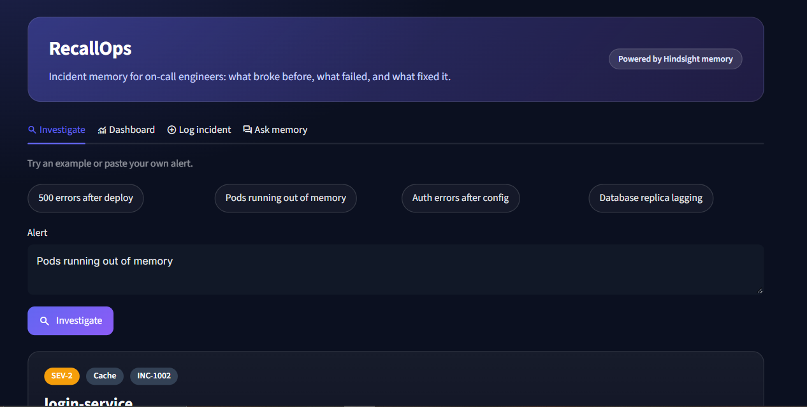
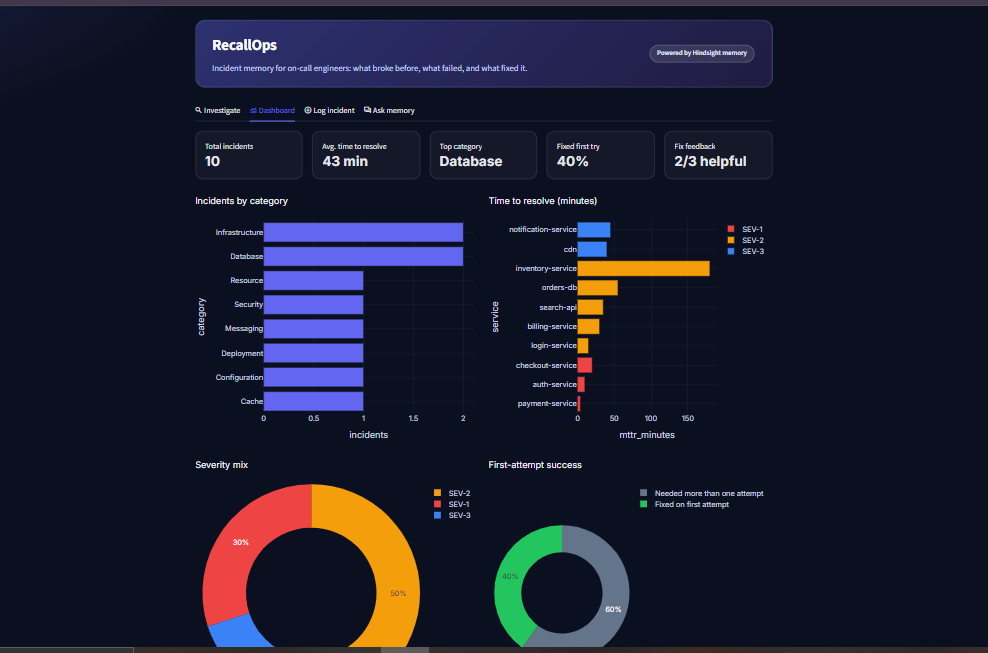

# RecallOps

Incident memory for on-call engineers. Paste a production alert and RecallOps
recalls the closest past incident: its root cause, what was tried and failed,
and what finally fixed it.




## The problem
When an alert fires at 3am, the fix often already exists in an old ticket, a
chat thread, or someone's head. RecallOps gives that history a searchable home,
including the failed attempts, so nobody repeats them.

## Features
- **Investigate:** paste an alert and get an incident card with severity, time
  to resolve, root cause, what did not work, what worked, and a comparison
  against average resolution time.
- **No-match guard:** if nothing in memory shares meaningful terms with the
  alert, the app says so instead of showing a misleading fix.
- **Response plan:** one click asks Hindsight to reflect across past incidents
  and produce a step-by-step plan, including approaches to avoid.
- **Feedback loop:** engineers mark a fix as helpful or not, and the outcome is
  stored back into memory.
- **Postmortem export:** download a ready-to-edit Markdown postmortem.
- **Ask memory:** a chat assistant that answers questions across all past
  incidents, and says so when memory has nothing relevant.
- **Dashboard:** KPIs and charts for incidents by category, time to resolve,
  severity mix, first-attempt success, and an incident timeline, with CSV export.
- **Log incident:** save a resolved incident to memory from the UI.

## How Hindsight memory is used
`retain` stores each incident (symptom, root cause, failed attempts, fix) and
each engineer's feedback. `recall` finds the closest past incident by meaning,
not keywords. `reflect` synthesizes response plans and chat answers across
incidents, including approaches to avoid. Every logged incident and feedback
click makes the next alert better.

## Tech stack
Python, Hindsight, Streamlit, Plotly, pandas

## Setup
```
python -m venv .venv
.venv\Scripts\activate
pip install -r requirements.txt
```
Create a `.env` file:
```
HINDSIGHT_API_KEY=your_key_here
```
Create the memory bank once, then load the sample incidents (run once each):
```
python -c "from memory import setup_memory; setup_memory()"
python seed_all.py
```
Start the app:
```
streamlit run app.py
```

## Related work
Commercial incident tools such as Rootly and PagerDuty AIOps already suggest
similar past incidents. RecallOps is a lightweight take on the same problem
built on an agent-memory layer, with failed attempts as first-class data and a
feedback loop that writes outcomes back into memory.

## Limitations
- Severity, category, date and time-to-resolve for the sample incidents are
  illustrative values defined in `store.py`. Hindsight stores the incident text.
- Recall always returns the nearest memories, so relevance is checked with a
  simple keyword-overlap heuristic. Alerts that share no words with a past
  incident may be reported as "no confident match".
- Sample incidents are fictional.