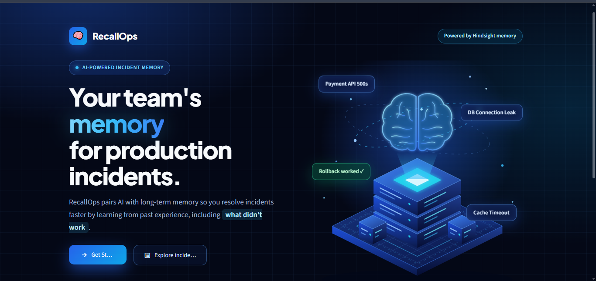
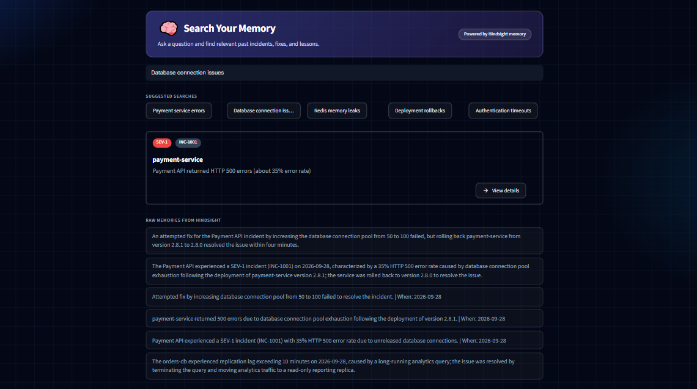

# 🧠 RecallOps

**Your team's memory for production incidents.**

RecallOps pairs AI with long-term memory so on-call engineers resolve incidents faster by learning from past experience — including what didn't work. Built on **Hindsight** agent memory.





## The problem

When an alert fires at 3am, the fix often already exists — in an old ticket, a Slack thread, or someone's memory. Most of the time nobody searches for it, so the same root cause gets re-diagnosed and the same dead-end fixes get retried. RecallOps gives that institutional knowledge a searchable, persistent home.

## Features

- **Home** — a live dashboard: total incidents, successful resolutions, feedback recorded, a memory-growth chart, and a feed of recent incidents.
- **Dashboard** — full analytics: incidents by month and day of week, category breakdown, time-to-resolve by service, resolution-time trend, category-vs-severity, severity mix, first-attempt success rate, an incidents-over-time timeline, and a detailed table (with year/month/weekday columns) exportable as CSV.
- **Memory Search** — paste an alert in plain language and get the closest matching past incident, with raw supporting memories from Hindsight underneath. This is the core "investigate an alert" workflow.
- **Incidents** — browse, search, and filter every past incident by service or severity.
- **Incident Detail** — a full case file per incident: Summary (problem, root cause, failed attempts, fix), Timeline (detected → failed attempts → resolved), Lessons Learned (key takeaway + related incidents), and a **feedback loop** (👍 Fix worked / 👎 Didn't help) that writes the outcome back into memory.
- **AI Assistant** — a full chat interface that reasons across *all* past incidents using Hindsight's `reflect`, distinguishing failed approaches (❌) from working fixes (✅), with suggested starter questions.
- **Report Incident** — log a new incident (service, severity, symptom, root cause, failed attempts, fix) directly into memory from the UI.
- **Settings** — connection status for Hindsight and Streamlit, memory bank stats (incidents stored, feedback entries), and organization info.
- **No-match guard** — when nothing in memory is genuinely related to a query, the app says so instead of confidently showing an unrelated fix.

## How Hindsight memory is used

- **`retain`** stores every incident (symptom, root cause, failed attempts, fix) and every engineer's feedback as it happens.
- **`recall`** finds the closest past incident to a new alert by meaning, not keyword matching — alerts phrased completely differently from the original incident text still find the right match. This powers Memory Search.
- **`reflect`** synthesizes answers across multiple incidents at once — used by the AI Assistant to reason over the whole incident history rather than a single record.
- **The feedback loop** writes 👍/👎 outcomes back into memory, so the system's picture of "what actually worked" improves as engineers use it.

## Tech stack

Python, Streamlit (multi-page `st.navigation`), Plotly, pandas, Hindsight.

## Project structure

```
Recallops/
├── app.py                    # navigation shell
├── theme.py                  # shared styling, CSS, reusable UI components
├── memory.py                 # Hindsight client wrapper (retain / recall / reflect)
├── store.py                  # incident data, feedback log, keyword matching
├── charts.py                 # all Plotly chart builders
├── handle_alert.py           # alert → closest-incident search helper
├── seed_all.py                # loads sample incidents into a fresh Hindsight bank
├── pages_/
│   ├── welcome.py             # landing page
│   ├── home.py                # dashboard summary
│   ├── dashboard.py           # full analytics
│   ├── incidents.py           # incident list + search/filter
│   ├── incident_detail.py     # single incident view + feedback
│   ├── memory_search.py       # investigate an alert — natural-language memory search
│   ├── assistant.py           # AI chat assistant
│   ├── report_incident.py     # log a new incident
│   └── settings.py            # connections & memory bank stats
├── .streamlit/config.toml     # theme config
├── requirements.txt
└── .gitignore
```

## Setup

```
python -m venv .venv
.venv\Scripts\activate
pip install -r requirements.txt
```

Create a `.env` file:
```
HINDSIGHT_API_KEY=your_key_here
```

Create the memory bank once, then load the sample incidents (run once each):
```
python -c "from memory import setup_memory; setup_memory()"
python seed_all.py
```

Start the app:
```
streamlit run app.py
```

## Example

**Alert (in Memory Search):** `Pods keep restarting and running out of memory`
**Result:** inventory-service, unbounded in-memory cache. Doubling the pod memory limit failed; adding an LRU cache with a maximum size fixed it in 180 minutes.

## Related work

Commercial incident tools such as Rootly and PagerDuty AIOps already suggest similar past incidents. RecallOps is a lightweight take on the same problem built on an agent-memory layer, with failed attempts as first-class data and a feedback loop that writes outcomes back into memory.

## Limitations

- Severity, category, date, and time-to-resolve for the sample incidents are illustrative values defined in `store.py`. Hindsight stores the incident text itself.
- Recall always returns the nearest memories, so relevance is checked with a keyword-overlap heuristic. Alerts that share no words with any past incident may correctly show "no confident match."
- Sample incidents are fictional, built for demonstration.
- This is a hackathon prototype: no authentication, single shared memory bank, no real-time alert ingestion (PagerDuty/Slack integration).